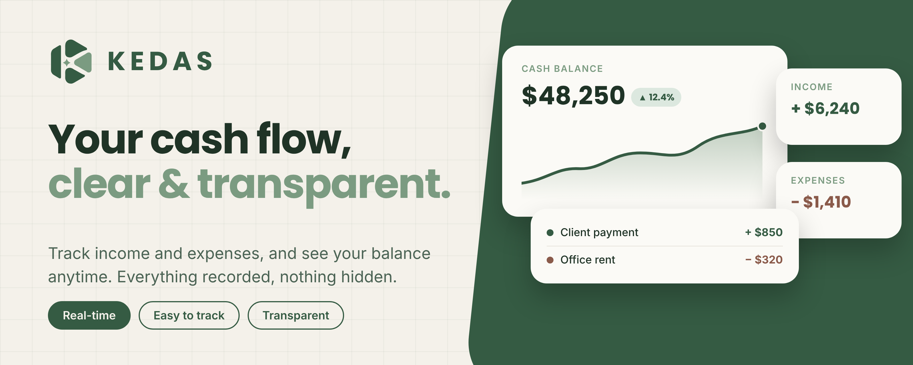

 

<h1>KEDAS</h1>

 
 

 

 

### Organization treasury that is clear, transparent, and always within reach.

Record dues, track expenses, and see exactly who still owes, all in one place. 
**Treasurers record. Everyone else can see. Nobody has to ask twice.**

 

 

---

## 💡 Why KEDAS

Collecting dues should not be a spreadsheet chore or a group-chat argument. 
KEDAS replaces the notebook, the bank-transfer screenshot, and the "who has not paid yet?" message 
with **one shared view every member can trust.**

 

<table>
<tr>
<td align="center" width="25%" valign="top">
<h3>⚡</h3>
<b>Always current</b>
  
Every change appears on every device within moments. No refreshing, no stale copies.
</td>
<td align="center" width="25%" valign="top">
<h3>👀</h3>
<b>Open by design</b>
  
Members see the balance, income, spending, and their own payment status.
</td>
<td align="center" width="25%" valign="top">
<h3>📲</h3>
<b>Frictionless joining</b>
  
Scan a QR code or type a short code, pick your name, and you are in.
</td>
<td align="center" width="25%" valign="top">
<h3>🧾</h3>
<b>Backed by evidence</b>
  
Attach a receipt photo to any expense so every rupiah is accounted for.
</td>
</tr>
</table>

 

<table align="center" width="100%">
<tr>
<td align="center" width="16%"><h1>4</h1><b>WORKSPACES</b></td>
<td align="center" width="16%"><h1>3</h1><b>PAYMENT STATES</b></td>
<td align="center" width="16%"><h1>6</h1><b>EXPENSE CATEGORIES</b></td>
<td align="center" width="16%"><h1>6+1</h1><b>ACCENT COLORS</b></td>
<td align="center" width="16%"><h1>3</h1><b>WAYS TO JOIN</b></td>
<td align="center" width="16%"><h1>1</h1><b>EXCEL BACKUP</b></td>
</tr>
</table>

---

## ✨ Features

Everything a treasurer needs, nothing they have to explain twice.

 

<table>
<tr>
<td width="33%" valign="top">
<h3>📊 Dashboard</h3>
Live balance, a cash goal with progress bar, drill-down totals, and every member's own status at the top.
</td>
<td width="33%" valign="top">
<h3>💰 Payments</h3>
Weekly or monthly dues, automatic statuses, per-member history, and batch recording.
</td>
<td width="33%" valign="top">
<h3>🧾 Expenses</h3>
Categorized spending with photo proof you can zoom into, filtered by date and category.
</td>
</tr>
<tr>
<td width="33%" valign="top">
<h3>🔔 Notifications</h3>
Automatic reminders, admin announcements, and push notifications on the phone.
</td>
<td width="33%" valign="top">
<h3>🔗 Share links</h3>
Share the dashboard in the group chat with a preview card of the balance, income, and expenses. Members only.
</td>
<td width="33%" valign="top">
<h3>🔐 Join and settings</h3>
QR or code to join, rotating codes, light and dark themes, Excel export and import.
</td>
</tr>
</table>

 

Want the details? Open any section below.

<b>📊 Dashboard</b> — the full picture in one glance

 

- **Live balance card.** Opening balance plus income minus expenses, calculated automatically. If spending ever exceeds income, the card turns red with a clear warning.
- **Cash goal.** Set a named target, such as a trip or an event, and a progress bar shows how close the organization is.
- **Drill-down totals.** Total income, expenses, and arrears are each a tap away from the filtered list behind the number.
- **Personal status card.** Members see their own standing at the top: fully paid, or exactly how much is outstanding.
- **Recent activity.** The ten latest transactions, income and expenses together, each opening to its full detail.

<b>💰 Payments</b> — dues tracking without the chasing

 

- **Three clear statuses.** *Paid* means every elapsed period is settled. *Unpaid* means something is owed but not yet late. *Overdue* means a due date has passed. The due date is the last day of each period.
- **Search and filter.** Find any member by name or narrow by status. The most urgent cases sit at the top.
- **Per-member history.** Every period with its due date and status, every payment with date and note, and the date of the last payment.
- **Smart allocation.** Payments fill the oldest period first. Anything paid beyond what is due is shown as extra instead of being lost.
- **Batch recording.** Select several members, everyone, or only those who are overdue, and record all payments in one step.
- **Safe corrections.** Delete a mistaken payment and income, balance, and arrears are recalculated instantly.

<b>🧾 Expenses</b> — every outgoing rupiah, documented

 

- **Categorized spending.** Cleaning, Stationery, Photocopy, Event, Decoration, and Other, each with a free-text note.
- **Photo proof.** Capture a receipt with the camera or pick one from the gallery. Images are resized automatically to stay light and fast.
- **Tap to inspect.** Open any expense to view and zoom into the receipt. Items with proof are marked in the list.
- **Filter by date and category.** The total of what you are looking at updates alongside.
- **Edit or remove.** Admins can correct or delete any entry, and the balance follows immediately.

<b>🔔 Notifications</b> — reminders that do the chasing for you

 

- **Automatic reminders.** Overdue members, or those with a due date approaching, appear in the notification bell without anyone sending a message. The window is configurable, from same-day up to thirty days ahead.
- **Privacy where it counts.** Admins see every reminder. Members see only their own.
- **Two focused tabs.** *Organization* for announcements and payment reminders. *KEDAS* for product news and updates.
- **Admin announcements.** Message the whole organization or only overdue members, from a ready-made template (such as a dues reminder or a balance update) or your own text.
- **Reach preview.** Before sending, see how many members have phone notifications enabled.
- **Phone push and installable app.** Once notifications are allowed, announcements reach the notification bar even when KEDAS is closed. On iPhone and iPad (iOS 16.4 or later), add KEDAS to the Home Screen first. KEDAS installs to the home screen on iPhone, iPad, Android, and desktop. A friendly offline screen replaces browser errors.

<b>🔗 Share links</b> — transparency you can post in a group chat

 

Admins share the dashboard with one tap from the Dashboard page.

- **A preview card made for the moment.** KEDAS draws a fresh card showing the organization name, the date, the balance, total income, and total expenses. It is attached to the link, so it unfurls in messaging apps. It never includes member names or transaction history.
- **Members only.** Opening the link asks the recipient to sign in with the organization first, then takes them straight to the dashboard.
- **Red when it matters.** If the balance is negative, the card turns red.
- **Native sharing.** Uses the phone's share sheet where available, with a copy-link fallback.

<b>🔐 Joining, access, and settings</b> — simple for members, secure for the organization

 

- **Three ways in.** Scan the QR code, attach a screenshot of it, or type the organization code, then pick your name from a searchable list.
- **QR kit for admins.** Copy the code, share the QR through the share sheet, or download it as an image with the organization name.
- **Rotate the code any time.** If a code leaks, generate a new one. The old one stops working immediately.
- **Admin account.** Email and password sign-in, email confirmation, and password reset by email.
- **Treasury configuration.** Organization name, weekly or monthly dues, amount, start date, opening balance, and reminder lead time. Changing any of them recalculates every status.
- **Member management.** Paste a list with one name per line to add many at once. Duplicates are skipped.
- **Appearance.** Light, dark, or system mode, six accent colors plus a custom picker, and an optional organization-wide theme that admins can require for everyone.
- **Data ownership.** Export one four-sheet Excel workbook (Settings, Members, Payments, Expenses), restore from it later, or load demo data to explore.

---

## 🚀 How it works

From zero to a transparent treasury in four steps.

 

<table>
<tr>
<td align="center" width="25%" valign="top">
<h1>1</h1>
<b>Create</b>
  
Name the organization, choose weekly or monthly dues, set the amount, and sign up as the admin.
</td>
<td align="center" width="25%" valign="top">
<h1>2</h1>
<b>Invite</b>
  
Add your members, then share the code or QR. They scan or type it, and pick their name.
</td>
<td align="center" width="25%" valign="top">
<h1>3</h1>
<b>Record</b>
  
Log payments and expenses as they happen. Balance and arrears update themselves.
</td>
<td align="center" width="25%" valign="top">
<h1>4</h1>
<b>Stay clear</b>
  
Members check their own status any time. Reminders and announcements handle the follow-up.
</td>
</tr>
</table>

---

## 👥 Roles

Two roles, one source of truth.

 

| | 🧑‍💼 Admin (Treasurer) | 🙋 Member |
|---|:---:|:---:|
| **Signs in with** | Email and password | Organization code or QR, then their name |
| **View balance, income, expenses** | ✅ | ✅ |
| **View own payment status** | ✅ | ✅ |
| **Record payments and expenses** | ✅ | ❌ |
| **Manage members and settings** | ✅ | ❌ |
| **Send announcements** | ✅ | ❌ |
| **Export and import data** | ✅ | ❌ |
| **Accounts per organization** | One admin | No fixed member limit |

> [!IMPORTANT]
> Permissions are enforced at the database level with row-level security, not just hidden in the interface.

### 🧮 The math, in plain sight

KEDAS keeps its accounting rules simple and visible, so anyone can verify them with a calculator.

| Concept | Definition |
|---|---|
| **Balance** | Opening balance + total income − total expenses |
| **Amount due** | Dues per period × number of periods that have started |
| **Outstanding** | Amount due − amount paid, never below zero |
| **Overdue** | At least one period whose due date has passed without full payment |
| **Total arrears** | The outstanding amount of every member who is unpaid or overdue |

---

## 🛠️ Built with

| | |
|---|---|
| **Frontend** | [Vite](https://vitejs.dev) and plain JavaScript. No heavy framework, so it loads fast on any phone. |
| **Backend** | [Supabase](https://supabase.com): Postgres with row-level security, Auth, Realtime, and Edge Functions. |
| **Hosting** | [Vercel](https://vercel.com) for deployment and the serverless function behind share previews. |
| **Installable** | A PWA with a service worker, an offline fallback screen, and Web Push notifications. |
| **Share previews** | The preview card is drawn in the browser, stored in Supabase Storage, and served to messaging apps by a serverless function on Vercel. |
| **Joining** | [jsQR](https://github.com/cozmo/jsQR) to scan QR codes and [qrcode](https://github.com/soldair/node-qrcode) to generate them. |

---

## ❓ FAQ

 

<b>Is KEDAS free?</b>

 
Yes. KEDAS is free to use, with nothing to buy. Open it in a browser and start, or add it to your home screen if you want it to feel like an app.

<b>Where is the data stored, and can I keep my own copy?</b>

 
Data lives on the server, not in the browser, so it survives a lost phone or a new laptop. You can also export a complete Excel archive from Settings whenever you like.

<b>Can members edit anything?</b>

 
No. Members can view the balance, income, expenses, and their own payment status. Only the admin can record or change data.

<b>What if the organization code is leaked?</b>

 
Generate a new code from Settings. The old one stops working at once, and members use the new one to sign in.

<b>What if the admin forgets their password?</b>

 
Choose "Forgot password?" on the admin sign-in page and follow the link sent by email. The password can also be changed from Settings.

<b>Weekly or monthly dues?</b>

 
Either. Choose in Settings, along with the amount and start date. Every status is recalculated automatically when you change it.

<b>Can I try it with sample data first?</b>

 
Yes. Load demo data from Settings to explore every screen, then reset to a blank slate when you are ready.

<b>Does it work well on a phone?</b>

 
It is designed for it. The layout adapts to the screen, navigation moves to the bottom, and KEDAS can be installed to the home screen like a native app.

<b>Why am I not receiving phone notifications?</b>

 
Allow notifications for KEDAS when asked. On iPhone and iPad (iOS 16.4 or later), add KEDAS to your Home Screen first, open it from there, then enable notifications.

<b>What happens if the balance goes negative?</b>

 
The balance card turns red and displays a warning that spending has exceeded income.

<b>What language and currency does KEDAS support?</b>

 
The interface is currently in Indonesian, and amounts are shown in Indonesian rupiah (IDR). More currencies are planned.

---

 

## 🌱 Ready for a clearer treasury?

Create your organization in under a minute and invite your members today.

 
 

## ❤️ Support KEDAS

KEDAS is free and built in spare time. If it helps your organization, a small tip keeps it going.

 
 

&copy; KEDAS. All rights reserved. The source code is available for viewing only. Copying or redistribution requires written permission.

 

